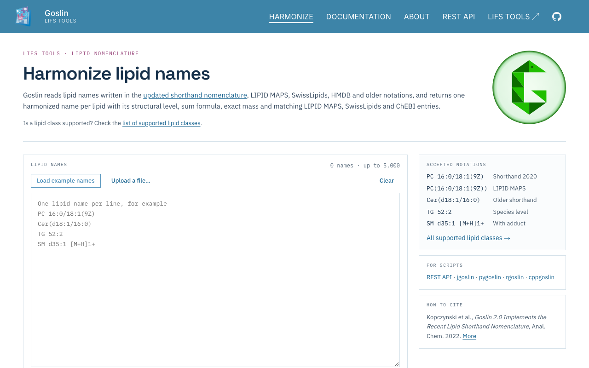
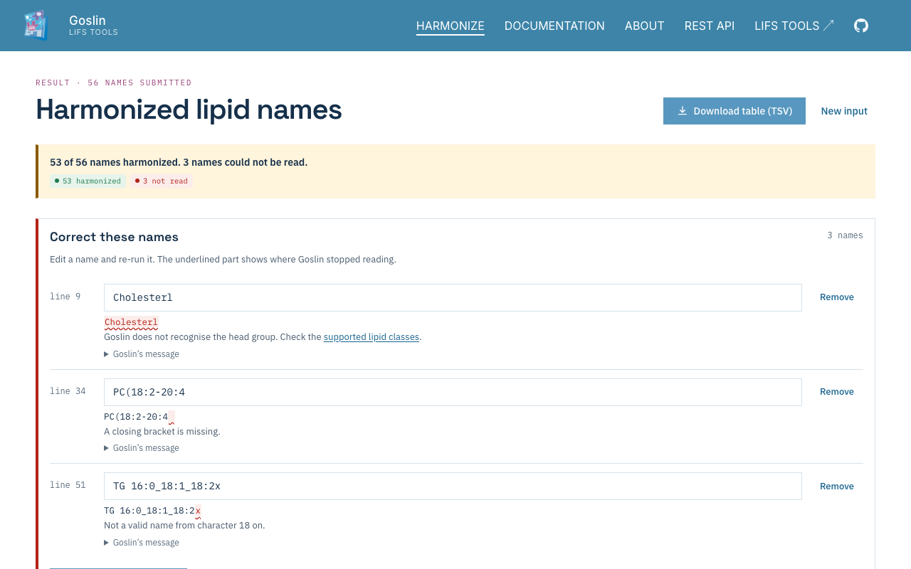

= LIFS Goslin Webapplication
Nils Hoffmann &lt;nils.hoffmann@cebitec.uni-bielefeld.de&gt;

image:https://zenodo.org/badge/DOI/10.5281/zenodo.3829054.svg["DOI", link="https://doi.org/10.5281/zenodo.3829054"]
//Build status: image:https://travis-ci.org/nilshoffmann/jmzTab-m-webapp.svg?branch=master["Build Status", link="https://travis-ci.org/nilshoffmann/jmzTab-m-webapp"]

This project provides a webapplication for the jgoslin library. It reads lipid names, one per line, checks them against the lipid shorthand nomenclature and returns them in the harmonized shorthand notation with classification, mass, sum formula and links to external databases. Names that cannot be read are listed on the result page, where they can be corrected and re-run.

== Related Projects
- https://github.com/lifs-tools/goslin[Goslin grammars and test files]
- https://github.com/lifs-tools/jgoslin[Java implementation]
- https://github.com/lifs-tools/cppgoslin[C++ implementation]
- https://github.com/lifs-tools/csgoslin[C# implementation]
- https://github.com/lifs-tools/pygoslin[Python implementation]
- https://github.com/lifs-tools/rgoslin[R implementation]

Further documentation about the projects is available https://github.com/lifs-tools/goslin/tree/master/docs[here].

== Building the project from the command-line

The project needs Java 25 (the Maven wrapper downloads Maven). To build the project and run the unit tests, execute the following command from a terminal:

	./mvnw install

== Running the Web Application 
The web-application is based on https://projects.spring.io/spring-boot/[Spring-Boot] and http://www.thymeleaf.org/[Thymeleaf], with plain CSS and JavaScript in the design of the LIFS application portal (no JavaScript libraries).
The `target` folder holds all necessary dependencies and resources as a stand-alone, executable JAR file that can be run as follows (please replace <VERSION> with the correct one)

  java -jar lifs-goslin-webapp-<VERSION>.jar

Results are stored as files below `storage.location` (default: the temporary directory) and are kept for 7 days. To use another folder, add `--storage.location=/path/to/folder`.

This will start the application with a default configuration, running on http port 8083. 
The application can then be accessed from your web browser at

  http://localhost:8083/goslin

== Building the Web Application Docker Image
If you want to run the web application as a docker container, you can build it as follows:

  ./mvnw -Pdocker install

This will build a Docker container for the webapplication and will make it locally available to be run by docker.

  docker image ls
  REPOSITORY              TAG            IMAGE ID     CREATED        SIZE
  lifs/lifs-goslin-webapp 2.0.1-SNAPSHOT 7347237b752e 16 seconds ago 274MB

To run the web application as a Docker container, type in the following (replacing <VERSION> with the current project version, i.e. the TAG version displayed by `docker image ls`):

  docker run -it --rm --name lifsgoslin -p 8080:8083 lifs/lifs-goslin-webapp:<VERSION>

You can then access the application from your browser at http://localhost:8080/goslin

